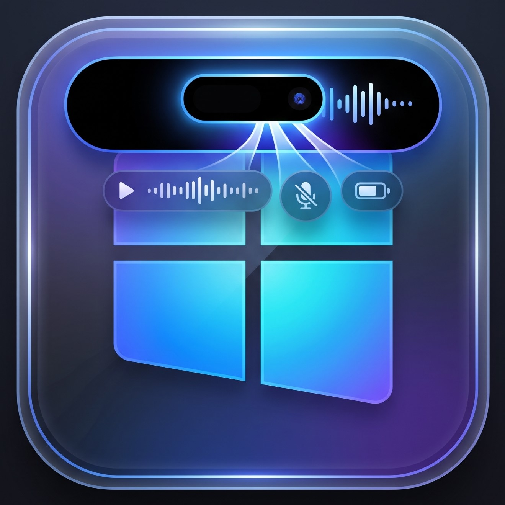

<div align="center">

  

  # 🏝️ Dynamic Island for Windows

  <p align="center">
    <b>A modern, fluid, and glassmorphic multitasking pill companion engineered for Windows 10 & 11.</b>
  </p>

  <p align="center">
    <a href="https://github.com/AbdiDzikry/Dynamic-Island-Windows/releases/latest"></a>
    <a href="https://github.com/AbdiDzikry/Dynamic-Island-Windows/releases"></a>
    <a href="https://github.com/AbdiDzikry/Dynamic-Island-Windows/stargazers"></a>
    <a href="LICENSE"></a>
  </p>

  <p align="center">
    <a href="#-key-features">Key Features</a> •
    <a href="#-quick-start--downloads">Download</a> •
    <a href="#-how-to-use">How to Use</a> •
    <a href="#-developer-setup">Developer Setup</a> •
    <a href="#-tech-stack">Tech Stack</a> •
    <a href="#-contributing">Contributing</a> •
    <a href="#-license">License</a>
  </p>

  <br />

  <p align="center">
    <a href="https://github.com/AbdiDzikry/Dynamic-Island-Windows/releases/latest">
      
    </a>
  </p>

</div>

---

## 📖 Overview

**Dynamic Island for Windows** brings the intuitive, context-aware pill widget to your desktop. Seamlessly anchored to the top of your screen, it remains discreet and unobtrusive during daily productivity, fluidly expanding into a feature-rich command hub whenever you hover over it.

Designed with clean glassmorphic aesthetics, fluid physics-inspired spring animations, and native Windows integration, it delivers desktop media control, live hardware monitoring, persistent quick-notes, and timekeeping in one lightweight package.

---

## ✨ Key Features

| Mode | Visual Preview | Description |
| :--- | :---: | :--- |
| **🎵 Windows Media Hub** | `🎵 Now Playing` | Native Windows GSMTC support (Spotify, Apple Music, YouTube, Soundcloud, Tidal). Displays high-res album thumbnails, real-time track progress bars, bold song titles, prominent artist badges (`👤 Artist`), and interactive playback controls (Play/Pause, Next, Prev). |
| **⚡ Hardware Monitor** | `⚡ System Vitals` | Live multi-metric hardware monitor with color-coded load bars for **CPU**, **RAM**, and **Battery percentage** + power status. Keep an eye on system health at a glance. |
| **📝 Multi Quick Note** | `📝 Notes (1–5)` | Instant scratchpad with 5 individual tabs. Take quick thoughts or phone numbers with one-click **📋 Copy to Clipboard** and **🗑️ Clear**. Persists automatically across PC reboots via local JSON storage. |
| **🕒 Aesthetic Clock** | `🕒 Minimal Time` | Clean digital clock featuring current live time, day of the week, full date, and year in elegant typography. Free from screen clutter. |
| **🚀 Glassmorphic Dock** | `Top-Right Navigation` | Seamless semi-transparent horizontal dock (`🎵`, `⚡`, `📝`, `🕒`) allowing 1-click jumps between all workspace modules. |

---

## 🎯 Smart Behavior & Intuitive Flow

- **Compact & Discreet by Default**: Rests quietly as a minimal indicator bar at the top of your screen.
- **Hover to Wake (Minimize)**: Hovering your mouse wakes the island into a compact mini bar showing title and visualizer.
- **Click for Details**: Simply click the minimize bar to fluidly expand into the full command hub (`345px`).
- **Smart 2-Stage Auto-Collapse**:
  - When your cursor leaves the detail panel for **2 seconds**, it automatically collapses back to minimize.
  - After **3 seconds** of no activity on minimize, it tucks smoothly back to its discreet compact state.
- **Ultra Lightweight Footprint**: Consumes `< 1% CPU` and minimal RAM memory using event-driven PyQt6 rendering and hardware acceleration.
- **Completely Offline & Private**: Zero telemetries, zero analytics, zero external network requests. All data stays strictly on your local PC.

---

## 📦 Quick Start & Downloads

### Option 1: Standalone Portable (Recommended ⭐)
> **No Python, no installation, and no admin rights required!**

1. Go to the [**Latest GitHub Releases**](https://github.com/AbdiDzikry/Dynamic-Island-Windows/releases/latest).
2. Download `DynamicIsland-v1.0.0-Portable.zip`.
3. Extract the folder anywhere you like (e.g., `C:\Tools\DynamicIsland`).
4. Double-click `DynamicIsland.exe` to run.

#### 💡 Optional: Auto-start with Windows
To have Dynamic Island launch automatically when you turn on your PC:
1. Press `Win + R`, type `shell:startup`, and hit **Enter**.
2. Right-click `DynamicIsland.exe` > **Create shortcut**.
3. Move that shortcut into the opened Startup folder.

---

### Option 2: Run from Source Code (For Developers)

#### Prerequisites
- **Windows 10** (Build 19041+) or **Windows 11**
- **Python 3.10** or newer installed

#### Step-by-Step Setup

```powershell
# 1. Clone the repository
git clone https://github.com/AbdiDzikry/Dynamic-Island-Windows.git
cd Dynamic-Island-Windows

# 2. (Optional) Create & activate virtual environment
python -m venv venv
.\venv\Scripts\Activate.ps1

# 3. Install dependencies
pip install -r requirements.txt

# 4. Launch application
python app.py
```

---

## 🛠️ Building Standalone `.exe`

Want to compile your own binary? PyInstaller is pre-configured:

```powershell
pyinstaller --noconfirm --onefile --windowed --icon="app_icon.ico" --name="DynamicIsland" app.py
```
Your compiled single-file binary will be generated under `dist/DynamicIsland.exe`.

---

## 💻 Tech Stack & Architecture

- **GUI Framework**: [PyQt6](https://www.riverbankcomputing.com/software/pyqt/) with native Windows Frameless & Top-Most window flags (`Qt.WindowType.WindowStaysOnTopHint`, `Qt.WindowType.Tool`).
- **Windows Media Engine**: `winrt-Windows.Media.Control` (Global System Media Transport Controls).
- **System Telemetry**: [psutil](https://github.com/giampaolo/psutil) for precision CPU, memory, and battery readings.
- **Image Processing**: [Pillow](https://python-pillow.org/) for rounded thumbnail rendering and album cover caching.
- **Packaging**: [PyInstaller](https://pyinstaller.org/) single-file binary packaging.

---

## 📂 Project Structure

```text
Dynamic-Island-Windows/
│
├── assets/                  # Icons and graphics
│   ├── app_icon.ico         # Application executable icon
│   ├── icon.png             # High-resolution PNG logo
│   └── icon2.jpeg           # Alternative branding asset
│
├── app.py                   # Core Dynamic Island engine & UI architecture
├── requirements.txt         # Project dependencies list
├── .gitignore               # Excluded build artifacts and caches
├── LICENSE                  # MIT License
└── README.md                # Documentation & showcase
```

---

## 🤝 Contributing

Contributions, issues, and feature requests are very welcome!

1. **Fork** the project (`https://github.com/AbdiDzikry/Dynamic-Island-Windows/fork`)
2. **Create** your feature branch (`git checkout -b feature/AmazingFeature`)
3. **Commit** your changes (`git commit -m 'feat: Add some AmazingFeature'`)
4. **Push** to the branch (`git push origin feature/AmazingFeature`)
5. **Open** a Pull Request

---

## 🌟 Support

If you find this project useful or enjoyable, please consider giving it a **Star ⭐** on GitHub! It helps more people discover the project.

---

## 📜 License

Distributed under the **MIT License**. See [`LICENSE`](LICENSE) for full details.

<div align="center">
  <p>Crafted with passion by <a href="https://github.com/AbdiDzikry"><b>Abdi Dzikry</b></a></p>
</div>
